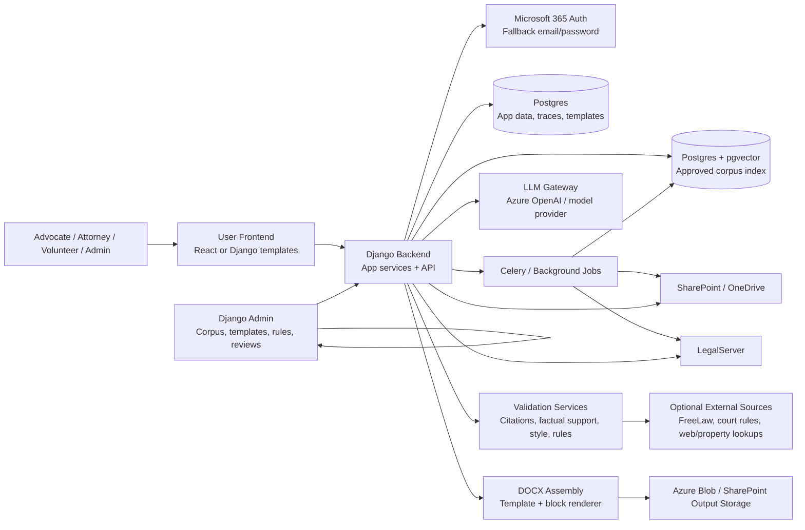
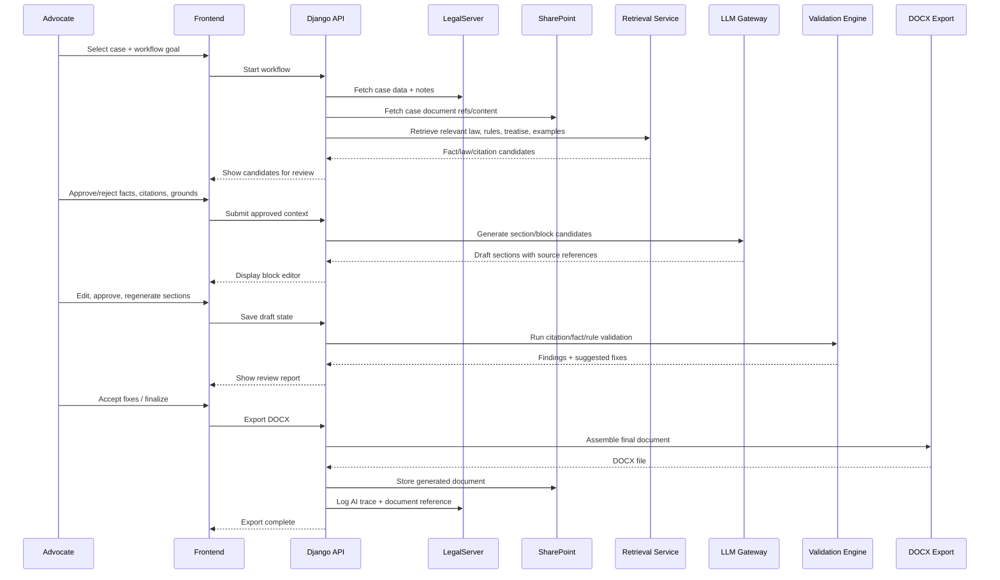
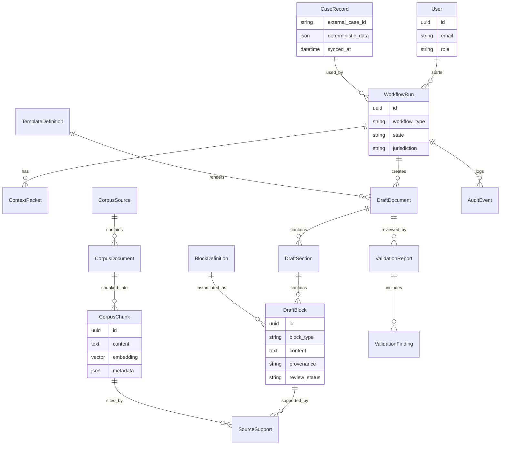

# Django AI Drafting Platform: Architecture and Delivery Plan

## 0. Working assumptions

This plan assumes Django is the main backend and the Django admin is the internal/admin frontend. The end-user application may use React, especially if the rich-text/block editor uses Lexical or another React-centered editor. The plan also assumes the project remains grounded in approved housing-law materials, LegalServer, SharePoint, role-based access, logging/audit, and human review of AI outputs.

The major product direction is an agentic AI research and drafting platform that can pull case context, retrieve approved legal materials, help an advocate select facts/law/grounds, draft sections, validate outputs, and produce editable documents.

## 1. High-level system diagram



## 2. Major components and services to build

### A. Identity, roles, and tenant access

Purpose: authenticate users, map them to roles, and enforce what they can view or do.

Likely responsibilities:

* Microsoft 365 OAuth login.
* Optional email/password fallback.
* Role-based access for staff, attorneys, volunteers, admins, and possibly reviewers.
* Permissions for case access, corpus management, template editing, draft generation, and final export.

Primary Django apps:

* `accounts`
* `organizations`
* `audit`

Key interfaces:

* `get_user_role(user) -> Role`
* `can_access_case(user, case_id) -> bool`
* `can_generate_document(user, workflow_type) -> bool`
* `record_auth_event(user, event_type, metadata)`

### B. LegalServer connector

Purpose: retrieve case data, notes, documents, metadata, and log AI activity back to LegalServer.

Likely responsibilities:

* Search/select a LegalServer case.
* Pull deterministic case information: parties, contact info, problem codes, special problem codes, office, assigned advocate, important dates.
* Pull case notes and document metadata.
* Log AI traces, draft-generation events, and final document references.
* Potentially update selected fields, if later approved.

Primary Django app:

* `integrations.legalserver`

Key interfaces:

* `search_cases(query, user) -> list[CaseSummary]`
* `get_case(case_id) -> CaseRecord`
* `get_case_documents(case_id) -> list[CaseDocumentRef]`
* `get_case_notes(case_id) -> list[CaseNote]`
* `write_ai_trace(case_id, trace: AITrace) -> TraceReceipt`
* `attach_generated_document(case_id, document_ref) -> AttachmentReceipt`

### C. SharePoint connector and document ingestion

Purpose: ingest approved housing-law materials, retrieve case documents, and store generated outputs.

Likely responsibilities:

* Maintain an approved SharePoint source inventory.
* Pull documents for indexing.
* Retrieve case-related documents through the SharePoint bridge.
* Store exported DOCX/PDF outputs.
* Support monthly corpus updates.

Primary Django apps:

* `integrations.sharepoint`
* `corpus`
* `ingestion`

Key interfaces:

* `list_approved_sources() -> list[SourceRef]`
* `sync_source(source_ref) -> IngestionRun`
* `fetch_document(document_ref) -> BinaryDocument`
* `store_generated_document(case_id, file, metadata) -> StoredDocumentRef`
* `get_source_inventory() -> list[CorpusSource]`

### D. Corpus ingestion, OCR, parsing, chunking, and indexing

Purpose: transform approved legal materials and case documents into searchable, attributable context.

Likely responsibilities:

* File extraction from DOCX, PDF, HTML, images, and scanned documents.
* OCR/photo recognition through MarkItDown, Docling, Azure Document Intelligence, or similar.
* Chunking strategies: simple chunks, chapter-level chunks, structured/graph-like chunks.
* Metadata enrichment: jurisdiction, court, source type, publication status, citation, date, topic, legal issue, office, workflow relevance.
* Embedding and vector indexing in Postgres/pgvector.

Primary Django apps:

* `ingestion`
* `corpus`
* `search`

Key interfaces:

* `parse_document(file) -> ParsedDocument`
* `chunk_document(parsed_doc, strategy) -> list[Chunk]`
* `extract_metadata(parsed_doc) -> CorpusMetadata`
* `index_chunks(chunks) -> IndexingResult`
* `search_corpus(query, filters, top_k) -> list[SearchResult]`
* `search_by_citation(citation) -> list[CitationResult]`

### E. Retrieval and context selection service

Purpose: find and rank the materials that should be shown to the user and sent to the LLM.

Likely responsibilities:

* Retrieve treatise provisions, case decisions, statutes/regulations, sample pleadings, court rules, and case-specific evidence.
* Localize results by jurisdiction/court when possible.
* Let advocates approve, reject, or rank facts/evidence/law before generation.
* Produce context packets with citations and source attribution.

Primary Django apps:

* `retrieval`
* `workflows`

Key interfaces:

* `retrieve_for_workflow(case_id, workflow_goal, filters) -> RetrievalPacket`
* `suggest_citations(case_id, grounds) -> list[CitationCandidate]`
* `suggest_facts(case_id, grounds) -> list[FactCandidate]`
* `build_context_packet(approved_items) -> ContextPacket`
* `explain_result(result_id) -> SourceAttribution`

### F. Workflow orchestration / drafting agent

Purpose: guide each drafting workflow through predictable, reviewable stages.

Likely responsibilities:

* Case intake audit / discrepancy spotting.
* Workflow goal selection: eviction answer, motion to dismiss, advice letter, legal research question, next steps.
* Grounds/defense/counterclaim suggestion.
* Missing-facts questionnaire generation.
* Section-by-section drafting.
* Regeneration with user instruction.
* State machine for human approval checkpoints.

Primary Django apps:

* `workflows`
* `ai_orchestration`
* `drafting`

Key interfaces:

* `start_workflow(case_id, workflow_type, user) -> WorkflowRun`
* `advance_workflow(run_id, action, payload) -> WorkflowState`
* `suggest_grounds(run_id) -> list[GroundCandidate]`
* `generate_missing_info_questions(run_id) -> Questionnaire`
* `generate_section(run_id, section_type, context_packet, instruction=None) -> DraftSection`
* `regenerate_section(section_id, instruction) -> DraftSectionCandidate`

### G. Template, clause, and block management

Purpose: manage reusable legal content, Jinja/DOCX templates, court-specific modules, and block-level metadata.

Likely responsibilities:

* Store document shells: letterhead, caption, signature block, certificate of service, court-specific formatting.
* Store reusable clauses/blocks with metadata: when to use, jurisdiction, issue, citations, elements, required facts, validation rules.
* Allow Django admin editing and versioning.
* Support Word templates with Jinja conventions for deterministic parts.
* Support database-managed internal blocks where Word alone is too limited.

Primary Django apps:

* `templates_app`
* `blocks`
* `rules`

Key interfaces:

* `list_templates(workflow_type, jurisdiction) -> list[TemplateSummary]`
* `get_template(template_id) -> TemplateDefinition`
* `list_blocks(filters) -> list[BlockDefinition]`
* `suggest_blocks(run_id, grounds, context) -> list[BlockCandidate]`
* `render_block(block_id, variables, context) -> RenderedBlock`
* `render_docx(template_id, approved_blocks, variables) -> GeneratedDocument`

### H. Rich-text / block editor

Purpose: give advocates a reviewable drafting workspace for prewritten and AI-generated blocks.

Likely responsibilities:

* Display sections as blocks: facts, legal argument, factual argument, prayer for relief, signature/caption.
* Show source support for claims and citations.
* Let users approve/reject suggested facts, citations, blocks, and AI edits.
* Allow manual edits without losing provenance.
* Track generated vs. human-edited content.

Primary frontend area:

* `frontend/editor` if React.
* Or Django templates + htmx for simpler workflows, though Lexical strongly favors React.

Key interfaces:

* `GET /api/workflows/{id}/draft-state/`
* `POST /api/sections/{id}/approve/`
* `POST /api/sections/{id}/regenerate/`
* `POST /api/claims/{id}/link-source/`
* `PATCH /api/draft-blocks/{id}/`
* `GET /api/draft-blocks/{id}/supporting-sources/`

### I. Validation and review engine

Purpose: check draft quality before export.

Likely responsibilities:

* Citation extraction.
* Citation validation using eyecite and FreeLaw/CourtListener-style APIs where available.
* Check whether cited propositions are supported.
* Check whether factual claims have evidence support.
* Check if a case is overruled or negative-treated if a source supports that.
* Check readability, passive voice, rules compliance, page length, local court formatting constraints.
* LLM-as-judge review for certain heuristics, with explicit uncertainty.

Primary Django apps:

* `validation`
* `citations`
* `rules`

Key interfaces:

* `extract_citations(text) -> list[Citation]`
* `validate_citations(citations) -> list[CitationValidationResult]`
* `validate_factual_support(section_id) -> list[SupportFinding]`
* `validate_rules(draft_id, ruleset_id) -> list[RuleFinding]`
* `run_final_review(draft_id) -> ReviewReport`
* `accept_suggestion(finding_id) -> Patch`

### J. Document assembly and export

Purpose: produce editable, final outputs.

Likely responsibilities:

* Merge deterministic data from LegalServer with approved blocks and user edits.
* Generate DOCX outputs.
* Optionally generate PDF previews.
* Store outputs in SharePoint and/or attach references in LegalServer.
* Preserve audit trace and draft label.

Primary Django apps:

* `documents`
* `exports`

Key interfaces:

* `build_document_package(draft_id) -> DocumentPackage`
* `generate_docx(package) -> FileRef`
* `store_output(file_ref, destination) -> StoredDocumentRef`
* `log_export(case_id, draft_id, stored_ref) -> AuditEvent`

### K. Audit, traceability, and evaluation

Purpose: support compliance, client trust, testing, and project acceptance.

Likely responsibilities:

* Store prompts, context packets, model versions, approvals, user edits, validation results, export events.
* Mark generated outputs for attorney review.
* Produce evaluation logs and closeout artifacts.
* Support monthly corpus update records.

Primary Django apps:

* `audit`
* `evals`

Key interfaces:

* `record_prompt(run_id, prompt, context_refs, model) -> PromptTrace`
* `record_user_decision(run_id, item_id, decision) -> DecisionTrace`
* `record_validation_report(draft_id, report) -> AuditEvent`
* `get_case_ai_activity(case_id) -> list[AITrace]`

## 3. End-to-end connection flow: motion or answer drafting



## 4. Suggested Django project layout

```text
project_root/
  manage.py
  pyproject.toml
  README.md
  .env.example

  config/
    settings/
      base.py
      local.py
      staging.py
      production.py
    urls.py
    celery.py
    asgi.py
    wsgi.py

  apps/
    accounts/
      models.py
      permissions.py
      adapters.py
      admin.py
      tests/
    organizations/
    audit/
      models.py
      services.py
      admin.py
    integrations/
      legalserver/
        client.py
        services.py
        schemas.py
        tasks.py
        tests/
      sharepoint/
        client.py
        services.py
        tasks.py
        tests/
      freelaw/
        client.py
    corpus/
      models.py
      admin.py
      metadata.py
      services.py
      tests/
    ingestion/
      parsers/
        docx.py
        pdf.py
        html.py
        image_ocr.py
      chunking.py
      embeddings.py
      tasks.py
      tests/
    retrieval/
      services.py
      ranking.py
      context_packets.py
      tests/
    templates_app/
      models.py
      renderers.py
      admin.py
      tests/
    blocks/
      models.py
      selection.py
      admin.py
      tests/
    rules/
      models.py
      engine.py
      admin.py
      tests/
    workflows/
      models.py
      state_machine.py
      services.py
      api.py
      tests/
    ai_orchestration/
      gateway.py
      prompts.py
      tools.py
      traces.py
      tests/
    drafting/
      models.py
      services.py
      api.py
      tests/
    validation/
      citations.py
      factual_support.py
      style.py
      rules.py
      services.py
      tests/
    documents/
      assembly.py
      docx_renderer.py
      storage.py
      tests/

  frontend/
    package.json
    src/
      api/
      components/
      workflows/
      editor/
      admin-lite/
      prototypes/

  templates/
    django_pages/
    emails/

  docx_templates/
    caption/
    signature_block/
    certificate_of_service/
    shells/

  docs/
    architecture/
    adr/
    api_contracts/
    wireframes/
    runbooks/
```

## 5. Data model sketch



## 6. Interface contract checklist by team/workstream

### Workstream 1: Platform/auth/admin

Owns:

* Django project setup.
* Azure deployment baseline.
* Microsoft auth.
* Django admin configuration.
* RBAC.
* Audit primitives.

Contracts needed by others:

* Permission functions.
* Audit event service.
* Current-user context for API calls.
* Environment/secrets conventions.

### Workstream 2: Integrations

Owns:

* LegalServer client.
* SharePoint client.
* Source inventory sync.
* Generated document storage.
* LegalServer AI trace logging.

Contracts needed by others:

* Stable `CaseRecord` schema.
* Stable `CaseDocumentRef` schema.
* Stable `StoredDocumentRef` schema.
* Error handling and retry conventions.

### Workstream 3: Corpus/retrieval

Owns:

* Parsing, OCR, chunking, metadata, embeddings.
* pgvector search.
* Retrieval filters.
* Context packet builder.

Contracts needed by others:

* `SearchResult` schema.
* `FactCandidate` schema.
* `CitationCandidate` schema.
* `ContextPacket` schema.

### Workstream 4: Templates/blocks/document assembly

Owns:

* Word/Jinja template conventions.
* Template metadata.
* Block database models.
* DOCX rendering/export.

Contracts needed by others:

* `TemplateDefinition` schema.
* `BlockDefinition` schema.
* `RenderedBlock` schema.
* `GeneratedDocument` schema.

### Workstream 5: AI workflows and prompt orchestration

Owns:

* Workflow state machine.
* Drafting-agent steps.
* Prompt templates.
* Section generation/regeneration.
* Missing-information questionnaire generation.

Contracts needed by others:

* `WorkflowRun` state transitions.
* Tool/function call interface.
* `DraftSection`/`DraftBlock` outputs.
* Prompt trace format.

### Workstream 6: Review/validation

Owns:

* Citation extraction and validation.
* Factual support checks.
* Rules/style checks.
* Review report UI payload.

Contracts needed by others:

* `ValidationReport` schema.
* `ValidationFinding` schema.
* Suggested patch format.
* Severity and confidence conventions.

### Workstream 7: Frontend/editor/prototypes

Owns:

* Workflow selection screens.
* Candidate review screens.
* Rich-text/block editor.
* Validation review UI.
* Export flow.
* Clickable prototypes.

Contracts needed by others:

* API endpoints from workflows/drafting/retrieval/validation.
* Mock payloads early.
* Editor save format.
* Source-hover and provenance format.

## 7. Recommended API surface for parallel development

```http
GET  /api/cases/search?q=
GET  /api/cases/{case_id}/
GET  /api/cases/{case_id}/documents/

POST /api/workflows/
GET  /api/workflows/{run_id}/
POST /api/workflows/{run_id}/advance/

POST /api/workflows/{run_id}/suggest-grounds/
POST /api/workflows/{run_id}/suggest-facts/
POST /api/workflows/{run_id}/suggest-citations/
POST /api/workflows/{run_id}/context-packet/

GET  /api/templates/?workflow_type=&jurisdiction=
GET  /api/blocks/?workflow_type=&jurisdiction=&issue=

POST /api/workflows/{run_id}/draft-sections/
PATCH /api/draft-blocks/{block_id}/
POST /api/draft-blocks/{block_id}/regenerate/
POST /api/draft-blocks/{block_id}/approve/

POST /api/drafts/{draft_id}/validate/
GET  /api/drafts/{draft_id}/validation-report/
POST /api/validation-findings/{finding_id}/accept/
POST /api/validation-findings/{finding_id}/dismiss/

POST /api/drafts/{draft_id}/export-docx/
GET  /api/exports/{export_id}/
```

## 8. Wireframes and clickable prototypes to prioritize

### Prototype 1: Case + workflow selection

Goal: confirm that advocates understand the starting point.

Screens:

* Search/select LegalServer case.
* Display high-level case summary and warning that case file may be incomplete.
* Choose workflow: eviction answer, motion to dismiss, advice letter, research question, next steps.
* Select jurisdiction/court/office when relevant.

Feedback to seek:

* Is this how advocates actually start?
* What case facts must be visible before they trust the workflow?
* What should happen when the case metadata is wrong or incomplete?

### Prototype 2: AI-suggested grounds/facts/citations review

Goal: validate the most important human-in-the-loop checkpoint.

Screens:

* List of suggested grounds or defenses.
* Fact candidates with source references.
* Citation candidates with jurisdiction/source badges.
* Check/uncheck/flag as wrong controls.
* Missing-fact questions suggested for the client.

Feedback to seek:

* Are suggestions grouped in the way lawyers think?
* Are confidence/source labels useful or distracting?
* What makes a suggestion trustworthy enough to carry forward?

### Prototype 3: Template and block selection

Goal: test the boundary between deterministic templates and AI-assisted generation.

Screens:

* Deterministic template list.
* “Create from scratch” button.
* Jurisdiction/rules selector.
* Prewritten blocks that can be turned on/off.
* Warnings when required facts are missing.

Feedback to seek:

* Which template choices should be explicit vs. automatic?
* What court-specific rules need to be visible?
* Are blocks too granular, too broad, or just right?

### Prototype 4: Rich-text block editor with source support

Goal: test the core drafting experience.

Screens:

* Document outline with sections.
* Prewritten and AI-generated blocks.
* Hover/click source support for facts and legal claims.
* Regenerate one block with instruction.
* Manual edit state and “AI generated / human edited” provenance.

Feedback to seek:

* Does the advocate understand where each claim came from?
* Can they efficiently edit without fighting the tool?
* What provenance or warning language is needed?

### Prototype 5: Validation review and suggested changes

Goal: validate final attorney-review workflow before export.

Screens:

* Review report grouped by citation issues, unsupported facts, rules/style issues, and local-court requirements.
* Suggested changes from AI.
* Accept/dismiss/manual edit controls.
* Link each finding to the affected document block.

Feedback to seek:

* Which validation findings are high-value vs. noise?
* What confidence level is required?
* Should volunteers see the same review UI as attorneys?

### Prototype 6: Export and logging

Goal: make sure the final handoff matches real work habits.

Screens:

* Final export confirmation.
* DOCX generated and stored.
* LegalServer AI trace/log entry preview.
* Optional SharePoint destination picker.

Feedback to seek:

* Where should final files live?
* What should be written back to LegalServer?
* What language should mark AI-assisted drafts?

## 9. Suggested build order

### Phase 1: Architecture and thin vertical slice

Build a single workflow end-to-end with mocks where needed:

1. Login.
2. Select mock or real LegalServer case.
3. Pull a few case facts/documents.
4. Retrieve a small approved corpus subset.
5. Suggest facts/citations.
6. User approves context.
7. Generate one facts section or advice-letter section.
8. Validate citations/factual support in a limited way.
9. Export DOCX.
10. Log trace.

### Phase 2: Corpus and retrieval hardening

* Expand SharePoint ingestion.
* Improve metadata and filters.
* Test chunking strategies.
* Add citation-aware retrieval.
* Add monthly update process.

### Phase 3: Template/block system

* Create caption, signature block, certificate of service templates.
* Add reusable block database.
* Add court/jurisdiction metadata.
* Implement deterministic + AI-generated block assembly.

### Phase 4: Full review UX

* Candidate review screens.
* Rich-text/block editor.
* Validation review.
* Regeneration and patch acceptance.

### Phase 5: Integrations, security, acceptance, training

* LegalServer logging and document workflow.
* SharePoint output storage.
* Role-based access controls.
* Audit and prompt logging.
* UAT, training, documentation, handoff.

## 10. Open architectural decisions to make soon

1. React/Lexical vs. simpler Django/htmx editor.

   * Recommendation: use React for the drafting workspace if block editing, provenance hovers, and source-linked claims are central.
   * Django admin remains the admin frontend.

2. Where block metadata lives.

   * Recommendation: database-managed `BlockDefinition` records for internal legal blocks, with DOCX/Jinja shells for document-level formatting.

3. How much LegalServer writeback in v1.

   * Recommendation: start with AI trace logging and generated-document reference; defer field updates unless required.

4. Citation validation depth.

   * Recommendation: start with extraction + existence checks + internal source support; add negative treatment/overruling as a later enhancement if dependable sources are available.

5. Review workflow hierarchy.

   * Recommendation: build flexible review-status fields now, but do not overbuild delegated approval workflows unless the client confirms it is in scope.

6. Case document OCR pipeline.

   * Recommendation: abstract parser/OCR behind an interface so MarkItDown, Docling, Azure Document Intelligence, or other tools can be swapped after testing.

## 11. 80-percent interface-first planning checklist

Before heavy coding, align the team on:

* Exact `CaseRecord`, `CaseDocumentRef`, and `CaseNote` schemas.
* Exact `CorpusSource`, `CorpusDocument`, `CorpusChunk`, and metadata schemas.
* Retrieval result and context packet schemas.
* Workflow state machine and allowed transitions.
* Draft section/block JSON shape.
* Source support/provenance shape.
* Validation finding shape.
* DOCX template variable naming conventions.
* Audit trace event schema.
* API endpoint names and mock payloads.
* Frontend editor save format.
* Error/retry conventions for external systems.

## 12. Suggested immediate next artifacts

1. API contract document with example JSON payloads.
2. Database model diagram with first-pass Django models.
3. Workflow state diagrams for eviction answer, motion to dismiss, advice letter, and research question.
4. Figma/clickable prototypes for the six screens above.
5. Template/block authoring guide for the Django admin.
6. Corpus metadata taxonomy and source inventory spreadsheet.
7. Evaluation plan with gold-standard sample questions/documents.
